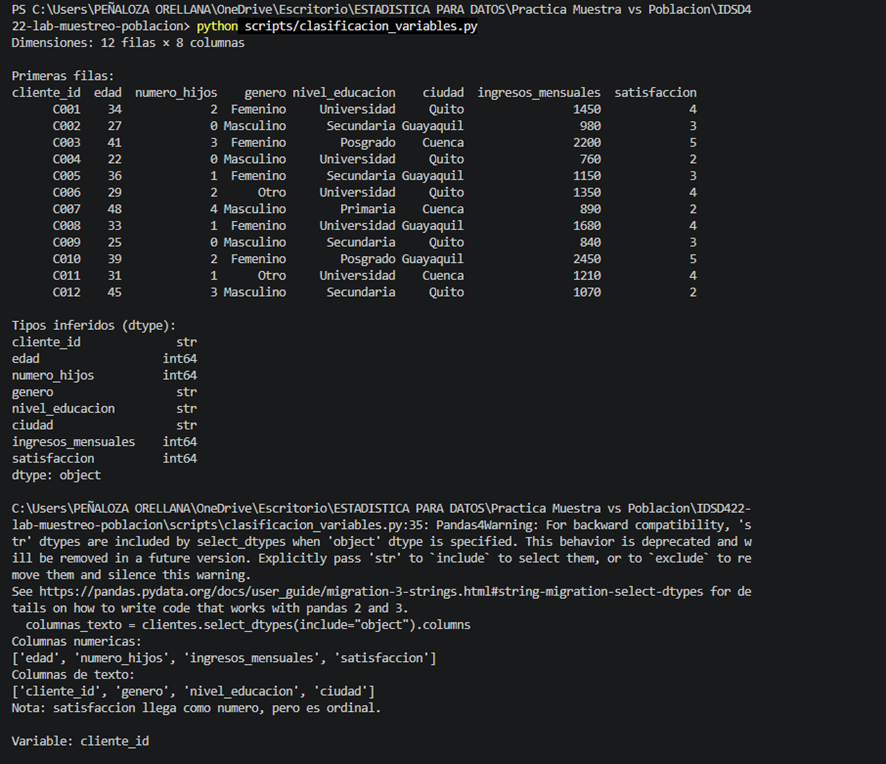
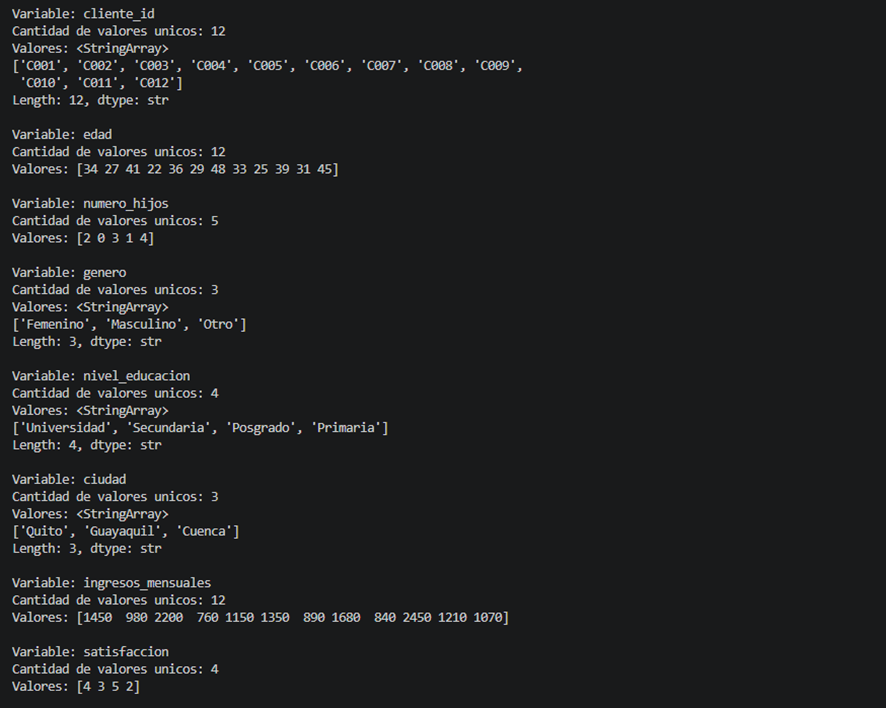
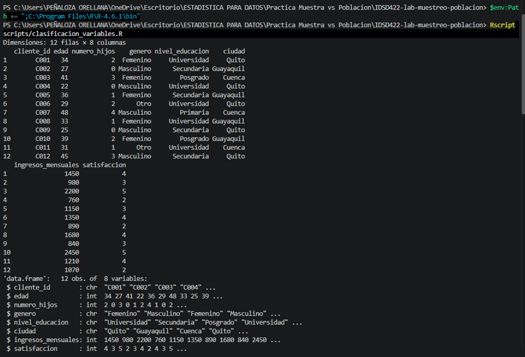
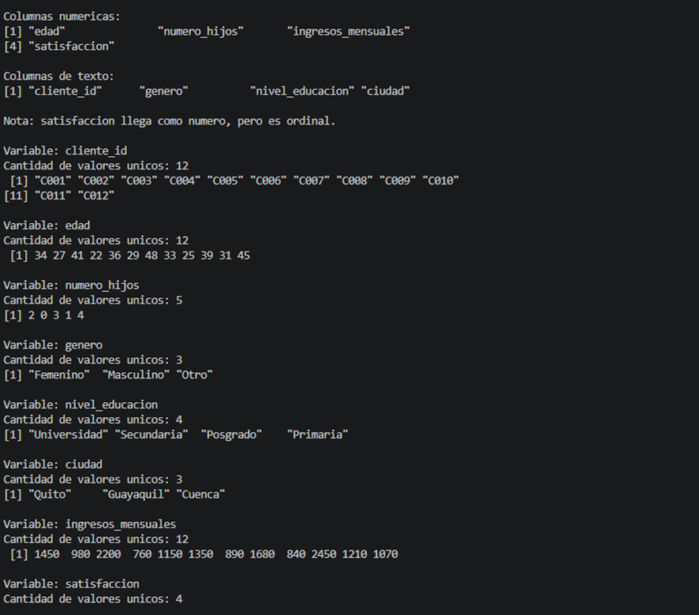
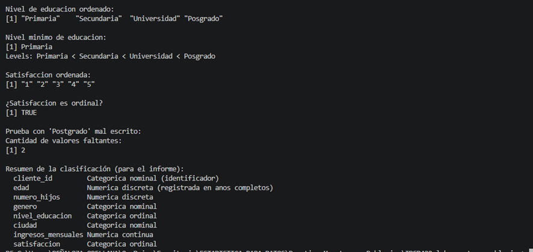
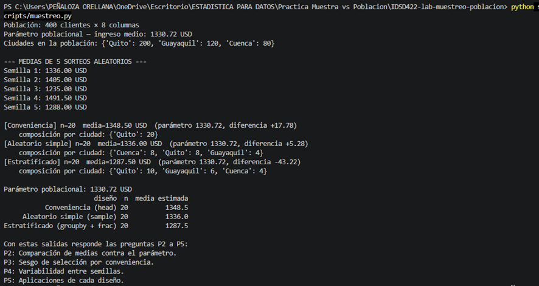
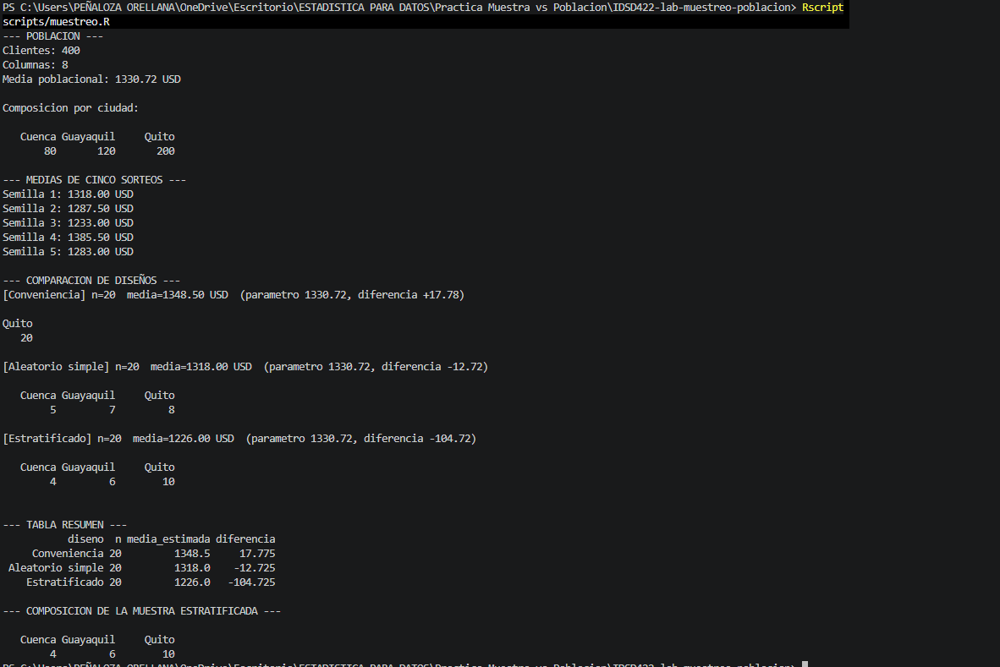
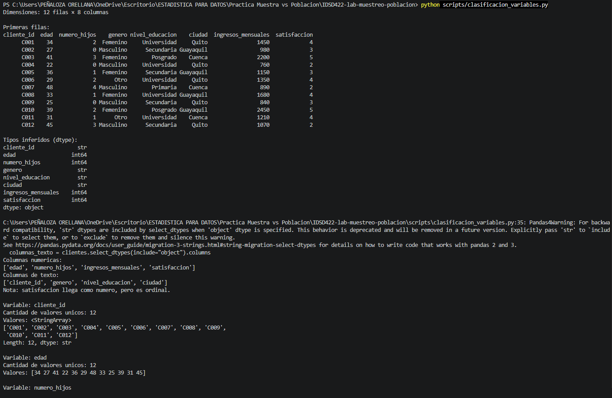
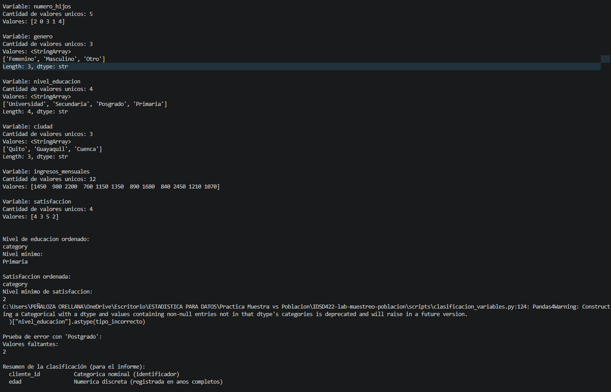
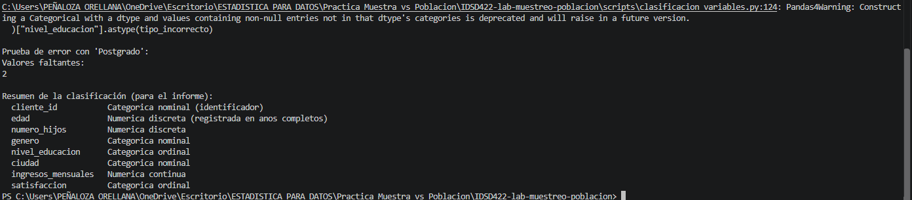

# Informe — Clasificación de variables y población vs. muestra

**Para:** Gerencia de RetailAndina S.A.  
**De:** Equipo de Business Intelligence  
**Estudiante:** Tabatha Peñaloza  
**Docente:** Christian Suarez  
**Asignatura:** IDSD422 — Estadística y Programación para Ciencia de Datos I  
**Período académico:** 2026-B  
**Fecha:** 23/10/2026  
**Repositorio (fork):** https://github.com/Tabatha-Orellana/IDSD422-lab-muestreo-poblacion  
**Asunto:** Clasificación de variables y estimación de ingresos mediante muestreo

---

## Resumen ejecutivo

Clasifiqué las variables de la base de fidelización de RetailAndina S.A. y verifiqué sus tipos y categorías mediante Python y R. Después calculé el ingreso mensual promedio de los 400 clientes (1.330,725 USD) y lo comparé con muestras de 20 clientes obtenidas por conveniencia, selección aleatoria simple y estratificación proporcional. Observé que las medias cambian según el diseño y el sorteo; por ello, la gerencia no debería juzgar la representatividad únicamente por el tamaño de la muestra o la cercanía de una sola estimación.

## 1. Introducción

RetailAndina S.A. necesitaba conocer las características de su base de fidelización y estimar el ingreso mensual promedio de sus clientes. Analicé primero un extracto de 12 registros para distinguir variables numéricas y categóricas, considerando si sus valores expresaban cantidades o categorías ordenadas. Luego estudié una población de 400 clientes y comparé tres formas de seleccionar 20 observaciones. Esta distinción es importante porque un tipo de dato mal interpretado puede conducir a cálculos inadecuados y una muestra seleccionada con sesgo puede excluir partes relevantes de la población (Bruce et al., 2020).

## 2. Objetivos

**Objetivo general:** Clasificar las variables de fidelización y comparar tres diseños de muestreo con el parámetro poblacional para evaluar sus limitaciones y su representatividad.

**Objetivos específicos:**

1. Identificar y justificar la clasificación estadística de las siete variables y el identificador de clientes.
2. Verificar los tipos inferidos, los valores únicos y el orden de las variables ordinales en Python y R.
3. Calcular el ingreso medio poblacional y contrastarlo con muestras de conveniencia, aleatorias simples y estratificadas de tamaño 20.
4. Examinar el sesgo de selección y la variabilidad entre cinco sorteos para formular recomendaciones a la gerencia.

## 3. Desarrollo de la práctica

### 3.1. Parte A — Clasificación de las variables

Leí `data/clientes.csv` en Python y R. El archivo contenía **12 registros y 8 columnas** (siete variables y un identificador). Inspeccioné `dtypes` y `str()`, y conté los valores únicos. Posteriormente declaré `nivel_educacion` y `satisfaccion` como categorías ordenadas mediante `CategoricalDtype` en Python y `factor(..., ordered=TRUE)` en R, siguiendo la documentación de pandas.

| Variable | Tipo estadístico | Justificación del criterio | Verificación en código |
|---|---|---|---|
| `cliente_id` | Categórica nominal (identificador) | Sus códigos identifican personas, no magnitudes ni jerarquías. | `str`/`chr`; 12 valores únicos. |
| `edad` | Numérica discreta en esta base | Está registrada en años completos; la edad subyacente puede concebirse como continua si se mide con mayor precisión. | `int64`/`int`; 12 valores únicos. |
| `numero_hijos` | Numérica discreta | Cuenta hijos; solo tienen sentido cantidades enteras no negativas. | `int64`/`int`; 5 valores únicos: 0, 1, 2, 3, 4. |
| `genero` | Categórica nominal | Sus categorías carecen de jerarquía; no es binaria en esta base. | `str`/`chr`; 3 categorías: Femenino, Masculino, Otro. |
| `nivel_educacion` | Categórica ordinal | Los niveles tienen un orden académico definido. | `str`/`chr` inicialmente; 4 categorías; orden: Primaria, Secundaria, Universidad y Posgrado. |
| `ciudad` | Categórica nominal | Quito, Guayaquil y Cuenca son etiquetas, sin orden. | `str`/`chr`; 3 valores únicos. |
| `ingresos_mensuales` | Numérica continua | Representa una cantidad monetaria que puede medirse con decimales, aunque este CSV registre enteros. | `int64`/`int`; 12 valores únicos. |
| `satisfaccion` | Categórica ordinal | Los números representan grados de satisfacción con orden, no distancias necesariamente equivalentes. | `int64`/`int` originalmente; 4 valores observados (2, 3, 4, 5); categorías declaradas 1–5 como ordenadas. |

**Comprobación del orden:** El nivel mínimo de educación fue `Primaria`; la satisfacción se declaró ordinal y el mínimo observado fue 2. Al utilizar incorrectamente `Postgrado` en vez de `Posgrado`, **dos registros quedaron como valores faltantes**. Esto mostró que los niveles deben escribirse de manera consistente.

**Código clave utilizado:** `pd.read_csv()`, `dtypes`, `unique()`, `pd.CategoricalDtype(..., ordered=True)`; en R, `read.csv()`, `str()`, `unique()` y `factor(..., ordered=TRUE)`.

**P1. ¿Qué indicó el dtype de `satisfaccion` y por qué no es suficiente? ¿Qué sucede si una ordinal queda como texto?**

El tipo inferido fue entero (`int64` en Python e `int` en R), pero eso solo indica su representación informática. Estadísticamente es ordinal porque sus valores señalan niveles ordenados de satisfacción. Si una variable ordinal queda como texto sin declarar el orden, un programa puede compararla alfabéticamente, mostrar categorías en un orden incorrecto o impedir operaciones basadas en la jerarquía. Por ello, definí explícitamente los niveles ordenados. La prueba de `Postgrado` generó dos faltantes, lo que confirmó la importancia de respetar las categorías exactas.

### 3.2. Parte B — Población vs. muestra

Analicé `data/clientes_400.csv`, compuesto por **400 clientes**: Quito (200), Guayaquil (120) y Cuenca (80). La variable de interés fue `ingresos_mensuales`. Calculé la media de toda la población para usarla como parámetro de comparación.

| Concepto | Valor |
|---|---|
| Población (N) | 400 clientes |
| Variable de interés | Ingresos mensuales (USD) |
| Parámetro poblacional (media exacta) | **1.330,725 USD** |
| Razón para muestrear | En situaciones reales, medir todos los registros puede requerir más tiempo y recursos. Aquí calculé el parámetro porque la base completa estaba disponible y servía como referencia para evaluar los diseños. |

**Resultados principales de Python (semilla 1):**

| Diseño | n | Media estimada (USD) | Composición por ciudad | Diferencia frente al parámetro (USD) |
|---|---:|---:|---|---:|
| Conveniencia (`head`) | 20 | 1.348,50 | Quito 20; Guayaquil 0; Cuenca 0 | +17,775 |
| Aleatorio simple (`sample`) | 20 | 1.336,00 | Quito 8; Guayaquil 8; Cuenca 4 | +5,275 |
| Estratificado (`groupby` + 5 %) | 20 | 1.287,50 | Quito 10; Guayaquil 6; Cuenca 4 | −43,225 |

**Medias de cinco sorteos aleatorios simples en Python (USD):**

| Semilla | 1 | 2 | 3 | 4 | 5 |
|---|---:|---:|---:|---:|---:|
| Media | 1.336,00 | 1.405,00 | 1.235,00 | 1.491,50 | 1.288,00 |

**Verificación independiente en R:**

| Diseño | Media (USD) | Composición por ciudad | Diferencia exacta (USD) |
|---|---:|---|---:|
| Conveniencia | 1.348,50 | Quito 20 | +17,775 |
| Aleatorio simple | 1.318,00 | Quito 8; Guayaquil 7; Cuenca 5 | −12,725 |
| Estratificado | 1.226,00 | Quito 10; Guayaquil 6; Cuenca 4 | −104,725 |

**Medias de cinco sorteos en R (USD):**

| Semilla | 1 | 2 | 3 | 4 | 5 |
|---|---:|---:|---:|---:|---:|
| Media | 1.318,00 | 1.287,50 | 1.233,00 | 1.385,50 | 1.283,00 |

Los valores de R y Python no tienen que coincidir en las muestras aleatorias: utilizan procedimientos y generadores de números aleatorios distintos, aun cuando se establezca la misma semilla. En ambos lenguajes, la muestra estratificada conservó la composición proporcional de la población: 10 clientes de Quito, 6 de Guayaquil y 4 de Cuenca.

**Código clave:** `head(20)`, `sample(n=20, random_state=1)`, repetición de semillas 1–5 y `groupby("ciudad").sample(frac=0.05)`; en R, `head()`, `set.seed()`, `sample()` y `dplyr::slice_sample(prop=0.05)`.

**P2. ¿Cuánto valió el parámetro y qué estimó cada diseño? ¿Cuál quedó más cerca y por qué no basta para declararlo ganador?**

El parámetro fue 1.330,725 USD. En Python obtuve 1.348,50 USD por conveniencia, 1.336,00 USD con aleatorio simple y 1.287,50 USD con estratificado. El aleatorio simple tuvo la diferencia absoluta menor en esta corrida (5,275 USD), pero una muestra favorable por azar no demuestra que ese diseño tenga siempre el menor error. Para comparar diseños de forma general se necesitan repeticiones y análisis de su variabilidad y sesgo.

**P3. ¿Qué defecto presenta la muestra por conveniencia? ¿Se corrige aumentando su tamaño?**

Aunque contenía 20 clientes, todos pertenecían a Quito. Excluyó por completo a Guayaquil y Cuenca porque se eligieron las primeras filas de una base ordenada. El problema es el mecanismo de selección, no solo el tamaño. Tomar más filas de manera igualmente sesgada no garantiza representatividad.

**P4. ¿Qué implica que las medias cambien entre semillas?**

Las cinco medias del muestreo aleatorio simple de Python oscilaron entre 1.235,00 y 1.491,50 USD. Esto evidencia variabilidad muestral: dos muestras seleccionadas al azar de una misma población pueden producir estimaciones diferentes. Para tomar decisiones, la gerencia debería considerar la incertidumbre y no tratar la estimación de una sola muestra como si fuera exacta.

**P5. ¿Cuándo conviene usar cada diseño?**

Utilizaría conveniencia para un piloto exploratorio, sin generalizar sus resultados a todos los clientes; aleatorio simple cuando necesite inferir sobre la población completa y disponga de un marco de selección adecuado; y estratificado si debo garantizar la presencia proporcional de las ciudades o comparar sus subgrupos. La elección depende del objetivo, la composición de la población y los recursos disponibles.

## 4. ¿Qué aprendí con esta práctica?

Aprendí que el tipo de dato mostrado por Python o R no sustituye su interpretación estadística. Antes consideraba suficiente identificar si una columna era numérica o de texto, pero comprobé que `satisfaccion` necesita un orden conceptual y que una categoría mal escrita puede producir valores faltantes. También reforcé el uso de `CategoricalDtype` y de factores ordenados, además de la diferencia entre variables discretas y continuas.

En la parte de muestreo comprendí por qué seleccionar veinte clientes no asegura representatividad: la muestra por conveniencia incluía solo Quito, mientras que la estratificada mantuvo las proporciones de las tres ciudades. Tuve dificultades para ejecutar el código en R porque PowerShell no reconocía `Rscript` en una sesión nueva y posteriormente faltaba el paquete `dplyr`. Configuré la ruta de R, instalé la dependencia y comprobé que el programa completara los tres diseños. En una próxima práctica verificaría las dependencias y las rutas antes de ejecutar los scripts, y planificaría las capturas desde el inicio.

## 5. Conclusiones

1. Clasifiqué las siete variables y el identificador de una base de 12 clientes; comprobé que `satisfaccion`, aunque se almacenó como entero, era ordinal y que escribir `Postgrado` en vez de `Posgrado` producía dos faltantes.

2. En la población de 400 clientes, la media mensual fue **1.330,725 USD**. Las tres muestras de tamaño 20 produjeron estimaciones diferentes; en particular, la muestra por conveniencia incluyó únicamente Quito, por lo que no representaba a las tres ciudades.

3. La variación entre semillas y las diferencias entre Python y R mostraron que una sola corrida no demuestra la superioridad de un diseño. Recomendaría a la gerencia seleccionar un mecanismo probabilístico acorde con sus objetivos, garantizar la representación de los subgrupos necesarios y comunicar la incertidumbre de las estimaciones.

## 6. Bibliografía

- Bruce, P., Bruce, A., & Gedeck, P. (2020). *Practical Statistics for Data Scientists* (2.ª ed.). O’Reilly Media.
- pandas development team. (s. f.). *pandas.CategoricalDtype*. https://pandas.pydata.org/docs/reference/api/pandas.CategoricalDtype.html
- pandas development team. (s. f.). *DataFrame.sample*. https://pandas.pydata.org/docs/reference/api/pandas.DataFrame.sample.html
- Wickham, H., François, R., Henry, L., Müller, K., & Vaughan, D. (s. f.). *dplyr: A grammar of data manipulation*. https://dplyr.tidyverse.org/
- RetailAndina S.A. (datos didácticos proporcionados en el repositorio del laboratorio). Archivos `clientes.csv` y `clientes_400.csv`.

**Declaración de uso de IA:** Utilicé ChatGPT como apoyo para aclarar instrucciones, revisar la organización del informe y orientar la solución de errores técnicos. Ejecuté los programas y contrasté los resultados con mis propias capturas de VS Code.

---

## 7. Anexos — Evidencias de ejecución

Las imágenes siguientes son capturas originales de mis ejecuciones en VS Code. Las figuras 1–5 documentan la clasificación, las figuras 6–7 el muestreo y las figuras 8–10 complementan la verificación en Python.

*Figura 1. Lectura de los doce registros y verificación de los tipos inferidos de las variables en Python.*

*Figura 2. Conteo y visualización de los valores únicos de las variables de fidelización mediante pandas.*

*Figura 3. Inspección de las ocho columnas y sus tipos mediante str() en R.*

*Figura 4. Identificación de valores únicos y categorías observadas en R.*

*Figura 5. Definición de niveles ordinales en R y detección de dos valores faltantes en la prueba con Postgrado.*

*Figura 6. Parámetro poblacional, medias de cinco sorteos y comparación de diseños de muestreo en Python.*

*Figura 7. Ejecución completa del muestreo en R: composición por ciudad, semillas y tres diseños.*

*Figura 8. Verificación adicional de dimensiones, registros y tipos de datos con Python.*

*Figura 9. Comprobación de ordinales y de los dos valores faltantes originados por un nivel educativo incorrecto en Python.*

*Figura 10. Resumen final de la clasificación estadística de las ocho columnas en Python.*
